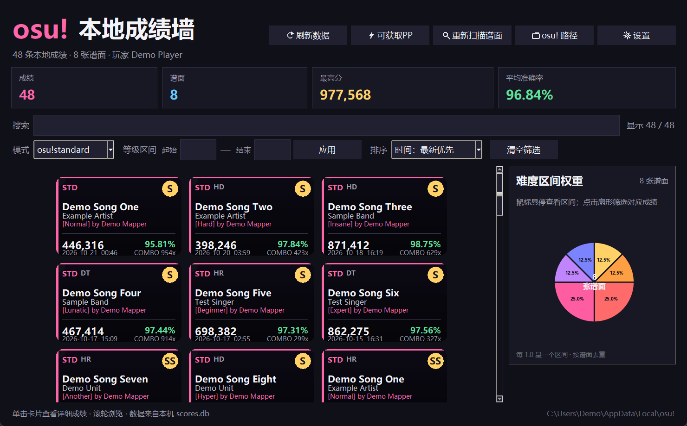

# osu! 本地成绩墙

一个使用 Python + Tkinter + Pillow + Matplotlib 编写的 osu! stable 本地成绩展示工具。

它会读取本机 `scores.db` 和 `Songs` 文件夹，把所有本地成绩用平铺卡片墙的方式展示出来，并自动匹配谱面封面、标题、艺术家和难度信息。



> 截图中的歌曲和成绩均为演示数据。

## 功能

- 平铺展示所有本地成绩
- 自动读取谱面封面作为卡片背景
- 按歌曲、艺术家、难度、模组等关键词搜索
- 按模式筛选：osu!standard / osu!taiko / osu!catch / osu!mania
- 主界面默认显示 osu!standard，可在「设置」中切换默认模式并保存
- 可获取 PP 查询：列出本地未提交的 Ranked 谱面成绩，并估算单曲原始 PP
- 主界面右侧常驻难度区间饼图，每 1.0 星一个区间
- 支持手动输入起始等级和结束等级，例如起始 `4.0`、结束 `5.0` 表示 4.0 ≤ ★ < 5.0
- osu!mania 模式下支持按 4K / 5K / 6K / 7K / 8K 等键数筛选
- 右上角按钮带有图标：刷新、重新扫描、osu! 路径和设置
- 按时间、分数、准确率、歌曲名排序
- 单击卡片查看详细成绩
- 准确率 ≥ 95% 显示为 S 评级
- 成绩详情中可查看同一谱面的全部历史成绩
  - 历史窗口显示游玩次数、最高分、平均准确率、最高连击
  - 点击历史成绩行会直接打开该成绩的详情界面
- 按游戏模式显示每种判定的个数：
  - osu!standard：300 / 100 / 50 / MISS
  - osu!taiko：300 / 100 / MISS
  - osu!catch：水果 / 滴 / 小滴 / MISS
  - osu!mania：MAX / 300 / 200 / 100 / 50 / MISS
- 显示分数、准确率、等级、最大连击、模组、谱面星级和时间
- 主界面右侧常驻谱面星级区间饼图，每 1.0 星一个区间，按谱面去重显示各区间权重
  - 鼠标悬停扇形时，扇形会稍微放大并显示该区间的谱面数、权重百分比
  - 点击扇形会自动把该区间的起始等级和结束等级写入两个输入框，并筛选对应成绩
  - 饼图会跟随当前模式和 mania 键数筛选更新
- 自动缓存谱面信息，减少重复扫描
- 支持刷新成绩和重新扫描谱面库

## 环境要求

- Windows
- Python 3.10+
- Pillow
- Matplotlib

安装依赖：

```powershell
python -m pip install -r requirements.txt
```

## 启动

双击：

```text
run.bat
```

或在 PowerShell 中运行：

```powershell
python main.py
```

首次启动时，如果软件没有自动找到 osu! 目录，会提示你选择包含 `scores.db` 和 `Songs` 的文件夹。

## 配置

程序会在本地生成 `config.json`：

```json
{
  "osu_dir": "C:\\Users\\你的用户名\\AppData\\Local\\osu!",
  "default_mode": "osu!standard"
}
```

也可以先复制示例配置：

```powershell
Copy-Item config.example.json config.json
```

然后修改里面的 `osu_dir` 和 `default_mode`。

`default_mode` 可选值：

- `osu!standard`
- `osu!taiko`
- `osu!catch`
- `osu!mania`

## 数据来源

- `scores.db`：本地成绩
- `Songs/**/*.osu`：谱面标题、艺术家、难度、封面等信息
- `osu!.db`：谱面星级、ranked 状态和 mania 键数信息，用于星级区间饼图、键数筛选和 PP 查询

本软件只读取本地文件，不会上传任何成绩或游戏数据。

## 项目结构

```text
osu成绩墙/
├─ main.py                 # Tkinter 界面与卡片墙
├─ osu_data.py             # scores.db 解析、谱面扫描与缓存
├─ pp_calc.py              # 使用 rosu-pp 估算单曲 PP
├─ run.bat                 # Windows 启动脚本
├─ requirements.txt        # Python 依赖
├─ config.example.json     # 配置示例
├─ .gitignore              # 不上传本地数据、缓存和配置
├─ LICENSE                 # MIT License
├─ README.md
└─ docs/
   └─ screenshot.png       # 演示截图
```

## 本地生成文件

以下文件由程序在本地生成，已经加入 `.gitignore`，不会上传：

- `config.json`
- `beatmap_cache.json`
- `__pycache__/`
- `preview*.png`

## 常见问题

### 启动时提示找不到 osu! 目录

请选择 osu! stable 的安装目录，目录中应同时存在：

```text
scores.db
Songs/
```

### 卡片没有封面

部分谱面文件夹中没有背景图片，软件会自动使用渐变占位背景。

### 成绩不是最新的

点击右上角「刷新数据」。如果谱面信息或星级缺失，再点击「重新扫描谱面」。

### 星级区间饼图显示没有数据

请确认 osu! 目录中存在 `osu!.db`，然后点击主界面的「重新扫描谱面」。

### 可获取 PP 的统计口径

点击右上角「可获取PP」后，软件会统计：

- 当前模式的本地成绩
- `online_id` 为 0 的未提交成绩
- `osu!.db` 中 Ranked / Approved / Qualified 状态的谱面
- 使用 `rosu-pp-py` 估算每张谱面的单曲原始 PP

注意：单曲 PP 估算不等于账号总 PP 会增加相同数值。最终是否提升总 PP，还要看线上个人最佳成绩、总 PP 权重和成绩是否成功提交。

### 是否支持 osu!lazer？

目前只支持 osu! stable 的 `scores.db`，不读取 osu!lazer 的数据库。

## License

本项目使用 MIT License，详见 [LICENSE](LICENSE)。

